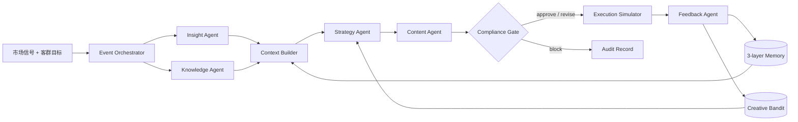

# FinLoop AI

> 面向证券与资管营销场景的、可审计的多智能体增长闭环平台。

FinLoop AI 把“洞察 → 决策 → 执行 → 反馈”实现成一条可复现的事件流。系统由 7 个职责隔离的智能体协作，支持预算感知的上下文组装、情景/语义/流程三层记忆、带原文引用的金融知识检索、产品适当性检查、营销内容合规闸门、幂等执行模拟和反馈学习。

项目默认完全离线运行，不需要模型密钥，也不会触达真实客户；配置 OpenAI 兼容接口后，可以让策略和内容智能体使用真实模型，其余安全边界保持不变。

## 为什么做这个项目

它针对以下真实工程问题，而不是做一个“多角色聊天”演示：

| 招聘能力 | 项目中的可验证实现 |
| --- | --- |
| multi-agent 核心架构 | 事件驱动、类型化状态、职责隔离、合规分支、完整运行轨迹 |
| 上下文工程 | 优先级装箱、token 预算、必选区块、PII 脱敏、上下文追踪 |
| Agent 记忆 | 情景、语义、流程三层记忆；按相关性、重要度和时间衰减召回 |
| 金融营销知识库 | 制度、适当性、市场手册和产品说明的混合检索与逐条引用 |
| 洞察—决策—执行—反馈 | 客群洞察、下一最佳行动、合规审查、执行模拟、bandit 学习闭环 |
| 工程化思维 | REST API、SQLite 持久化、幂等键、离线评测、测试、CI、Docker |

## 成品能力

- `Insight Agent`：把市场信号转成客群意图和可检验假设。
- `Knowledge Agent`：用 BM25 风格词法分数与哈希语义向量做融合排序，输出原文片段和来源编号。
- `Strategy Agent`：先过滤产品风险等级，再选择下一最佳行动；用 UCB1 在三种创意策略间平衡探索与利用。
- `Content Agent`：按渠道与客群生成教育型内容，保留知识引用。
- `Compliance Agent`：独立检查收益承诺、内幕暗示、适当性、风险披露和决策依据；可修复问题自动改写，风险倒挂直接阻断。
- `Execution Agent`：只做可复现仿真，生成幂等键、送达、打开与转化指标。
- `Feedback Agent`：把结果写回 bandit 和三层长期记忆，供后续任务召回。



## 5 分钟启动

要求：Python 3.11+、Node.js 20+。

```bash
cd /Users/hannn/project/finloop-ai
make install
make dev
```

打开：

- 控制台：<http://localhost:5173>
- API 文档：<http://localhost:8000/docs>

也可以用生产模式运行单容器：

```bash
docker compose up --build
```

然后打开 <http://localhost:8000>。

## 一次运行里发生了什么

1. `Orchestrator` 标准化任务并写入运行记录。
2. 洞察分析与知识检索并行执行。
3. `ContextBuilder` 对任务、客群、证据、记忆和洞察按优先级装箱，脱敏并记录 token 使用。
4. 策略智能体只从风险等级不高于客群等级的产品中选择方案。
5. 内容智能体生成渠道文案，合规智能体进行独立复核。
6. 通过后进入幂等仿真执行；未通过则在闸门处终止。
7. 执行反馈更新创意 bandit，并写回三种长期记忆。
8. 所有阶段、消息、证据、版本与结果都保存在事件轨迹中。

## 评测与测试

```bash
make test
make lint
make eval
```

当前内置评测覆盖：

- 稳健客群在高波动环境下的风险匹配；
- 成长客群再激活场景的知识依据；
- 专业客群多资产教育场景；
- 禁用词自动修订；
- 高风险产品向低风险客群推荐时的硬阻断；
- PII 脱敏与上下文预算；
- API 到持久化的端到端闭环。

本机基线：3/3 场景通过，引用召回率 100%，适当性检查 100%；这些是随仓库可复现的离线评测，不代表真实业务收益。

## API 示例

```bash
curl -X POST http://localhost:8000/api/runs \
  -H 'Content-Type: application/json' \
  -d '{
    "segment_id": "steady-planner",
    "objective": "向稳健客群解释市场波动与配置纪律",
    "market_signal": "权益市场波动放大，回撤咨询增加"
  }'
```

核心接口：

| 方法 | 路径 | 用途 |
| --- | --- | --- |
| `POST` | `/api/runs` | 发起完整多智能体闭环 |
| `GET` | `/api/runs/{id}` | 查询最终状态与所有产物 |
| `GET` | `/api/runs/{id}/events` | 获取可审计事件轨迹 |
| `GET` | `/api/knowledge/search?q=` | 查看混合检索结果 |
| `POST` | `/api/feedback` | 写入人工反馈并更新 bandit |
| `POST` | `/api/evals/run` | 运行离线评测集 |
| `GET` | `/api/architecture` | 返回运行时能力声明 |

## 切换真实模型

复制 `.env.example` 为 `.env`，或设置环境变量：

```bash
export FINLOOP_MODEL_PROVIDER=openai-compatible
export FINLOOP_MODEL_NAME=gpt-5-mini
export FINLOOP_API_KEY=your-key
export FINLOOP_BASE_URL=https://api.openai.com/v1
```

密钥只在服务端使用。模型调用失败、输出非 JSON 或超时时，系统会降级到确定性策略；适当性、合规和执行边界不交给模型判断。

## 项目结构

```text
finloop-ai/
├── backend/app/
│   ├── agents/          # 6 个领域智能体（知识检索由独立服务承担）
│   ├── core/runtime.py  # 事件驱动工作流与状态汇聚
│   ├── services/        # 检索、上下文、记忆、bandit、模型网关
│   ├── api/             # FastAPI 接口
│   └── evals.py         # 可执行离线评测
├── frontend/            # React + TypeScript 可视化运行台
├── data/knowledge/      # 可追溯的演示知识语料
├── evals/cases.json     # 场景评测集
├── docs/                # 架构与面试说明
└── .github/workflows/   # 自动测试、检查和构建
```

## 安全边界

- 项目中所有产品、客群和执行数据均为虚构。
- 默认模式不调用外部模型、不连接营销渠道、不构成投资建议。
- “通过合规规则”仅表示通过仓库内的演示规则，不能替代持牌机构的制度审查与人工复核。
- 上生产前需要接入真实身份权限、数据分级、密钥管理、模型审计、人工审批、正式规则引擎和消息系统。

## 设计参考

项目借鉴了 LangGraph 对线程内/跨线程记忆的区分，以及 AutoGen 的事件驱动和分层多智能体设计；核心运行时、上下文装箱、混合检索、合规闸门和反馈学习均在本仓库独立实现，避免把简历项目变成框架 API 的薄封装。

- [LangGraph memory concepts](https://github.com/langchain-ai/langgraphjs/blob/main/docs/docs/concepts/memory.md)
- [Microsoft AutoGen](https://github.com/microsoft/autogen)
- [LlamaIndex agent memory](https://github.com/run-llama/llama_index/blob/main/docs/src/content/docs/framework/module_guides/deploying/agents/memory.mdx)

更多实现取舍见 [docs/architecture.md](docs/architecture.md)，面试讲解见 [docs/interview-guide.md](docs/interview-guide.md)。
